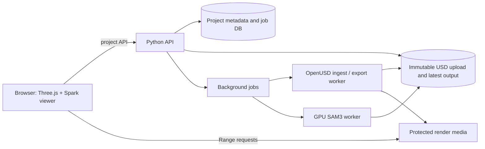

# USD Gaussian Segmentation on the Web: Foundation Design

Date: 2026-10-20  
Status: approved on 2026-10-20

## 1. Goal and scope

Build a locally hosted web application that lets one pilot user upload an existing USD Gaussian scene, inspect it in a Three.js viewer, capture views, run SAM3 segmentation, refine the resulting objects, edit asset metadata, and save new USD objects and review state. The browser, Python/OpenUSD service, storage, and SAM3 worker run on the same NVIDIA GPU PC. The uploaded source remains unchanged. There is no sign-in in the pilot; an unguessable project link grants read, edit, export, and delete access. Broader network access and multiple users are deferred until the pilot is stable.

The expected input includes multi-gigabyte scenes with more than 50 million splats. This scale rules out downloading all original Gaussian arrays into the browser. The server holds the original USD and authoritative source selections; the browser receives a bounded, streamable render derivative and compact previews.

This is a **three-build program**, not one implementation plan:

1. **Foundation (this spec):** project link and deletion, resumable USD upload, validation, stable source identity, conversion to a streamable render derivative, and a navigable Three.js/Spark viewer. The acceptance tests include a representative scene above 50 million splats.
2. **Segmentation and refinement (later spec):** A/B/C captures, GPU SAM3 jobs, mask review, server-side projection and cross-view matching, 3D preview, paint, erase, box, and merge.
3. **Save and metadata (later spec):** the latest saved USD output, restored review state, asset metadata forms and dropdowns for extracted objects, and a self-contained download.

The later builds must follow the interfaces and invariants below. Their detailed UI and algorithm choices receive separate specs and plans. The first build ends when a user can create a private-link project, upload a supported USD scene, navigate its streamed Gaussian content after validation, and delete the project. It does not claim segmentation is usable at that point.

## 2. Evidence from the current application

The current extension is an Omniverse Kit Python application. It reads Gaussian `positions`, `scales`, `orientations`, `opacities`, and spherical-harmonic coefficients from USD (`Source Code/nemy.asset_metadata_property-0.5.0/nemy/asset_metadata_property/crop_tool.py`, lines 23–29 and 1039–1051). Its extraction takes source-array indices, copies their attributes into a new prim under `/World/Objectified`, assigns a fresh `primId`, and preserves world placement (same file, lines 1054–1150). Its review flow uses source-point indices for mask projection and extraction (`mask_multi.py`, lines 76–131 and 372–413). Asset fields and dropdown types are declared in `extension.py`, lines 16–32 and 89–110. The [current extension README](../../../Source%20Code/nemy.asset_metadata_property-0.5.0/README.md) describes A/B/C capture, per-view mask review, 3D matching, refinement, and separate or combined extraction.

OpenUSD's [Gaussian ParticleField documentation](https://openusd.org/dev/user_guides/schemas/usdVol/overview.html) confirms the particle arrays and alignment requirements. [Spark 2.0 documentation](https://github.com/sparkjsdev/spark/blob/main/docs/docs/new-features-2.0.md) describes streamable LoD `.RAD` files, HTTP Range loading, fixed splat budgets, and a command-line LoD builder. **Design inference:** OpenUSD remains the authoritative editing format; Spark's LoD output is a rendering copy, because interior LoD nodes aggregate source splats and cannot serve as edit identities.

## 3. Architecture and boundaries

- **Browser:** project creation and upload progress, scene navigation, capture/review controls in later builds, bounded preview overlays, and metadata forms. It never loads the complete source arrays. Three.js owns camera and scene UI; Spark renders Gaussian splats.
- **Python API:** validates capability access, owns project and job records, coordinates uploads and workers, and exposes manifests and results. Its database stores metadata and references to large files, not Gaussian arrays.
- **OpenUSD worker:** opens staged input safely, validates composition and Gaussian attributes, inventories source prims, derives render data and a spatial/ID store, and later writes the saved output. Work is isolated from HTTP request timeouts and bounded by CPU, memory, disk, and duration limits.
- **GPU worker:** runs SAM3 on captured images in later build 2. It has bounded concurrency and independently reported status. The existing local service is an algorithm reference, not the application API.
- **Local storage:** holds uploaded bundles, derived render files, captures, masks, selections, and the latest output. The source upload is immutable. A database transaction publishes a completed output only after all files are durable.

Use a persistent local job table and one background worker process. Jobs continue when the browser tab closes and their status is restored when the project link is reopened. Do not add distributed orchestration or multi-worker infrastructure during the one-PC pilot.

## 4. Project access without sign-in

Creating a project returns an opaque project ID and a high-entropy capability secret. The link is `<app-origin>/p/<project-id>#key=<secret>`; the URL fragment is not sent with normal HTTP requests. The browser sends the secret in an authorization header for project APIs. The server stores a hash of the secret, never the plaintext; logs and telemetry redact authorization headers. Access to *every* project API, job status, upload, export, and deletion endpoint is checked against that capability.

The pilot binds to loopback by default and is opened from a browser on the same GPU PC. HTTPS, a domain, and an IP address are not prerequisites for local use. The capability model remains because it protects project URLs and supports a later hosted rollout. The user can rotate a project's secret; rotation immediately invalidates the old link.

Spark's media loader needs normal same-origin Range URLs. After a valid header exchange, the API issues a short-lived, project-scoped, HttpOnly, SameSite=Strict media cookie so the browser can request protected render chunks. The cookie is also `Secure` when the app uses HTTPS. It grants only media reads; state-changing APIs still require the capability header. The cookie is renewed while the link is open and invalidated on project deletion. The response uses private cache controls. No third-party client scripts or analytics receive the fragment.

Anyone holding the link can edit or delete the project. There is no account-based recovery if the link is lost. Projects remain available until a link holder deletes them; the UI provides a deliberate Delete Project action. Deletion immediately disables access, then purges the source, derivatives, review data, and saved output through a tracked job. Deployment documentation must state any backup-retention window before a public launch; the product must not claim immediate deletion from backups unless verified.

Disk, upload-size, archive-expansion, and GPU-job limits protect the pilot PC. Public rate limiting is deferred until the app is exposed beyond loopback.

## 5. Supported input and ingestion

Each pilot project accepts one self-contained `.usd`, `.usda`, `.usdc`, or `.usdz` file, or one `.zip` bundle containing a selected root USD stage and all local dependencies. A different source uses a new project. A loose USD file with unresolved external dependencies fails validation with a list of missing paths. External network or filesystem references are rejected; accepted references must resolve inside the staged bundle. ZIP processing rejects path traversal, links that escape the staging area, duplicate normalized paths, excessive expansion, and unsupported archive entries. The original bytes are retained as an immutable source revision.

Upload is resumable in fixed-size chunks. A server-side upload record tracks expected total size, chunk offsets/hashes, and completion. Retried chunks are idempotent. The server verifies the final digest before marking the upload complete. A restarted browser can resume with the project link and upload ID. Abandoned chunks are garbage-collected by a documented operational policy; completed projects are not deleted for inactivity.

The validation/conversion job:

1. Opens the selected root stage in a resource-limited worker and resolves only accepted local dependencies.
2. Enumerates Gaussian source prims and validates finite XYZ positions, aligned per-particle arrays, transforms, and nonempty content. The first release accepts static Gaussian attributes at the default time and rejects time-varying Gaussian attributes. Other unsupported scene constructs produce explicit errors; the input is never silently flattened or partially accepted.
3. Records stage up axis, `metersPerUnit`, per-prim local-to-world transform, source prim path, array length, and source revision ID.
4. Creates a server-side source index and spatial representation keyed by `(sourceRevisionId, sourcePrimPath, sourceIndex)`. `sourceIndex` is a 64-bit unsigned index into that prim's immutable `positions` array. These IDs are the only authoritative edit identifiers.
5. Converts Gaussian appearance and placement to a Spark-compatible intermediate, then builds a streamable LoD `.RAD` derivative. The first implementation must verify its converter against representative real USD scenes and check color, opacity, orientation, scale, and coordinate parity before accepting an asset. LoD aggregates never receive source edit IDs.
6. Publishes a manifest and render files only after all validation and conversion pass. Failure leaves the upload available for diagnosis or replacement but never exposes a half-built viewer scene.

The converter's intermediate representation and use of Spark's `build-lod` tool are implementation choices for the first plan, subject to a measured compatibility proof. The contract is a streamable artifact with HTTP Range support, bounded browser memory, and correct appearance and coordinates.

## 6. Coordinate and source-ID contract

The API manifest names each source prim and supplies its stable key, count, bounds, `sourceRevisionId`, a 4×4 `webFromUsdWorld` matrix, and the render asset URL. The matrix incorporates USD stage units and up-axis conversion into the viewer's meter-based, Y-up coordinate system. Every later camera capture stores its pixel dimensions, projection and view matrices, `webFromUsdWorld`, source revision, source prims, and a renderer/detail-ready flag. Server projection inverts the same transform and rejects missing or mismatched revision/matrix versions.

Selections and saved review state are sets of source IDs, represented in compact ranges or chunked bitmaps server-side. API edits carry a source revision and expected review-state version. The server rejects stale writes rather than applying an edit to a changed source or overwritten review state. Browser previews are sampled/streamed views of those selections, not a second source of truth.

The pilot assumes one person, but the version check still protects against two tabs overwriting one another. On conflict, the later tab must reload the latest state; live collaboration and edit locks are out of scope.

Render LoD completion is distinct from source-data completeness. A capture may start only after the current view meets a defined detail-ready condition; later build 2 must measure and expose that condition in the viewer. The captured image and matrices form one immutable record so masks cannot be projected using a different camera.

## 7. User flow and API contract for build 1

1. Open the app and create a project. Display and copy the secret link immediately.
2. Select a supported USD file or bundle, including the root stage for a bundle. Show size/quota and resumable upload progress.
3. After upload, show validation/conversion status and precise failure messages. Retain the uploaded source until replacement or deletion.
4. On success, load the project manifest, request `.RAD` chunks via Range, and navigate the Gaussian scene with bounds-based camera framing, source-prim visibility, and a visible loading/detail state.
5. Reload the link in a new browser session and recover the same project, source revision, and viewer state. The user can delete the project through a confirmation action.

Initial endpoints are conceptual contracts, not locked URL names: create project; rotate project secret; begin/query/upload/finalize chunks; get current source; start/query ingest job; get manifest; protected Range media; delete project. A job has `queued | running | succeeded | failed | canceled`, timestamps, phase, progress when measurable, and structured errors. Clients poll for job updates; reconnecting never starts duplicate work.

Later endpoints consume the same IDs and version rules: immutable capture creation; SAM3 job; mask review edits; apply/match job; source-ID selection edits; metadata update; save latest USD result; and export. Build 3 atomically replaces the previous successful saved result only after the new result is complete, then removes the superseded result. A failed save leaves the last successful result available and never changes the source.

## 8. Approved downstream behavior

- Each segmentation task has exactly three capture slots: A, B, and C. Missing surfaces are handled with those views, manual Paint/Erase/Box refinement, or a separate task; automatic completion from one view is not promised.
- SAM3 accepts at most 50 detected instances per view and reports an explicit error above that limit. The user can narrow the view or prompt and run another task.
- Saved review state restores captures, camera matrices, prompts, masks, mask edits, matched groups, source-ID selections, and extracted-object metadata.
- The metadata editor exposes every field from the current extension. `Generic Hard Asset` uses its maintained choices. `Functional Location` starts with values found in the uploaded stage and also accepts a custom value. Metadata editing applies only to extracted objects.
- The saved result is downloadable as a self-contained USD package that opens without the web app or original upload. Only the latest successful saved result is retained.
- Release-blocking visual checks cover geometry, transforms, color, scale, opacity, orientation, and bounds. Minor renderer-specific pixel differences from Omniverse are acceptable.

## 9. Failure behavior and security

- A chunk mismatch, digest failure, quota breach, or interrupted upload shows a recoverable error. Completed chunks remain available for retry until abandoned-upload cleanup.
- Invalid USD, unsupported arrays or composition, bad paths, or conversion failure leave no published render manifest. The UI reports the exact validation category without exposing server paths.
- Worker crashes and GPU failures are recorded on jobs; retry creates a new attempt against the same immutable inputs. The last good viewer, review state, and saved output stay available.
- Save jobs replace the latest output atomically. A stale source or review-state version fails before publication. Partial output files are cleaned up asynchronously.
- Capability checks run before reading project records or blobs. Use safe filenames, bounded archive extraction, content validation, same-origin CORS, security headers, and no shell execution of user-provided paths.

## 10. Acceptance and testing for build 1

The first build is accepted when the following pass on the intended hosting hardware:

- A small known USD Gaussian fixture uploads, converts, renders, and preserves its expected transform, scale, color, opacity, orientation, and bounds. Reopening its secret link restores access; a different or missing secret is denied.
- Rotating the capability secret invalidates the old link. Opening the current link from two tabs and submitting stale state produces a conflict instead of losing the newer change.
- A bundle with local references resolves correctly. External refs, path traversal, oversized expansion, malformed arrays, and unsupported time samples fail clearly without exposing files or publishing partial media.
- Interrupt a multi-gigabyte upload, resume it, verify the digest, and complete conversion once. Retries of the same chunk and job request do not duplicate project data.
- A representative input above 50 million splats completes ingestion within the target server's measured CPU/RAM/disk budget and displays in a bounded browser memory budget. Measure conversion time, disk amplification, Range behavior, initial view time, detail settling, and frame time. Set public performance targets only from these results; no unmeasured FPS promise is part of this design.
- Check a sample of `(sourcePrimPath, sourceIndex)` values against the original USD after conversion. The scene manifest's coordinate matrix round-trips sample points between USD and the viewer within a declared numeric tolerance.
- Failed or canceled conversion leaves the immutable source and any previously published viewer files intact. Delete Project disables access and purges project files; backup behavior matches the published deployment policy.

## 11. Deferred decisions and risks

The first real scene benchmark decides converter chunk size, worker memory allocation, render encoding settings, quotas, and performance targets. These are measured deployment values, not product semantics. A single OpenUSD array read may still require substantial server RAM even if browser loading is streamed; the benchmark must expose this before claiming support for a particular scene size. If Spark's `.RAD` path fails a visual parity or scale test, choose another Spark-supported streamable derivative while preserving the source-ID and manifest contracts.

Build 2 will specify exact mask matching, visibility, capture detail thresholds, and 3D refinement mechanics within the approved three-view and 50-instance limits. Build 3 will specify the self-contained USD package layout and field validation within the approved metadata, latest-save, and export behavior. Neither build may use the render LoD tree as the authoritative selection source.
